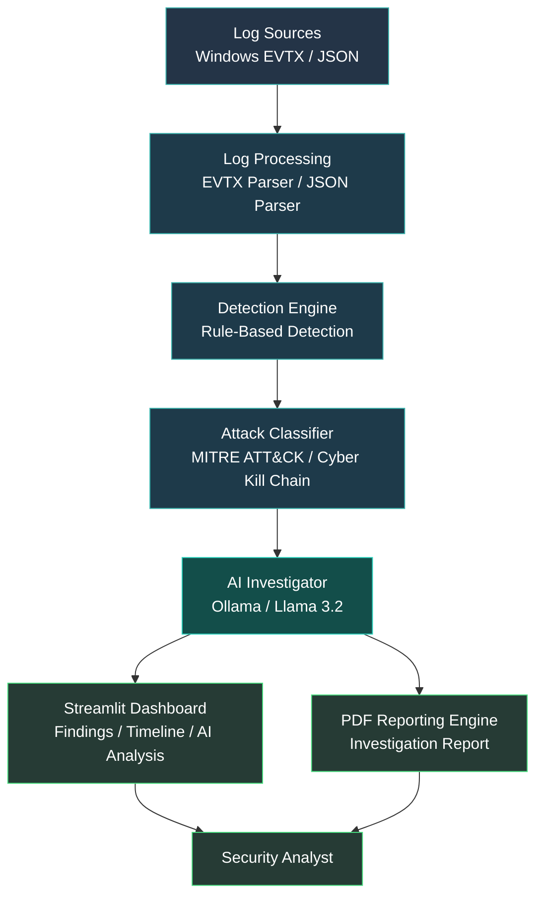

# 🔍 CyberTrace AI
### AI-Powered Cyber Incident Investigator

CyberTrace AI is a defensive cybersecurity investigation tool that analyses system logs, identifies suspicious activity, maps potential attack techniques, and generates structured investigation reports using a locally running AI model.

## System Architecture




## 🚀 Features

- **Log Processing:** Supports Windows EVTX and JSON log files.
- **Threat Detection:** Identifies suspicious authentication patterns.
- **MITRE ATT&CK Mapping:** Maps supported findings to potential attack techniques.
- **Cyber Kill Chain:** Provides tentative attack-stage classification.
- **AI Investigation:** Uses Llama 3.2 through Ollama to interpret findings.
- **PDF Reporting:** Generates downloadable investigation reports.
- **Interactive Dashboard:** Provides a Streamlit interface for log analysis.

## 🏗️ Architecture

```text
          Log Upload
               |
               v
         Log Processor
               |
               v
        Detection Engine
               |
               v
        Attack Classifier
               |
               v
         AI Investigator
               |
               v
        Report Generator
               |
               v
        PDF Investigation
```

## 🛠️ Technologies Used

- Python
- Streamlit
- Ollama
- Llama 3.2
- ReportLab
- python-evtx
- MITRE ATT&CK Framework

## 📁 Project Structure

```text
CyberTrace-AI/
│
├── ai_investigator/
├── attack_classifier/
├── dashboard/
│   └── app.py
├── data/
│   └── sample_logs/
├── detection_engine/
├── log_processor/
├── reporting/
├── utils/
│
├── requirements.txt
├── README.md
└── .gitignore
```

## ⚙️ Installation

### 1. Clone the repository

```bash
git clone YOUR_REPOSITORY_URL
cd CyberTrace-AI
```

### 2. Create a virtual environment

```bash
python -m venv venv
```

### 3. Activate it

Windows:

```powershell
venv\Scripts\activate
```

### 4. Install dependencies

```bash
pip install -r requirements.txt
```

### 5. Install and start Ollama

Install Ollama and download the model:

```bash
ollama pull llama3.2
```

Ensure the Ollama service is running.

### 6. Launch CyberTrace AI

```bash
python -m streamlit run dashboard/app.py
```

## 🔬 How It Works

1. Upload a Windows EVTX or supported JSON log file.
2. The log processor extracts relevant events.
3. The detection engine checks for configured suspicious patterns.
4. The classifier maps supported findings to MITRE ATT&CK.
5. The local AI model generates investigation analysis.
6. The reporting engine creates a downloadable PDF.

## ⚠️ Limitations

- Detection capabilities depend on configured rules.
- Not all suspicious activity can be identified from available logs.
- MITRE ATT&CK mappings are potential classifications, not proof of an attack.
- AI-generated interpretations require human verification.
- A lack of findings does not establish that a system is secure.

## 🔐 Privacy

AI analysis runs locally through Ollama. Uploaded logs are processed by the application and should be handled as sensitive security data.

## 👨‍💻 Project

**CyberTrace AI — AI-Powered Cyber Incident Investigator**
